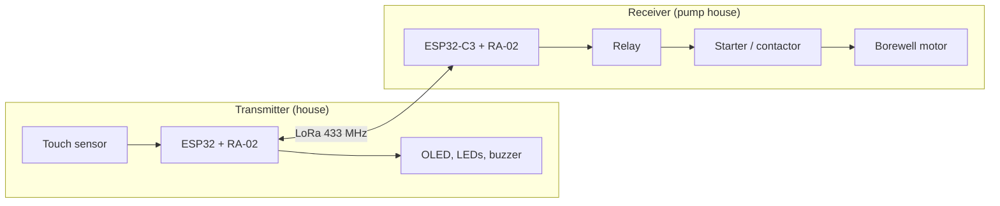
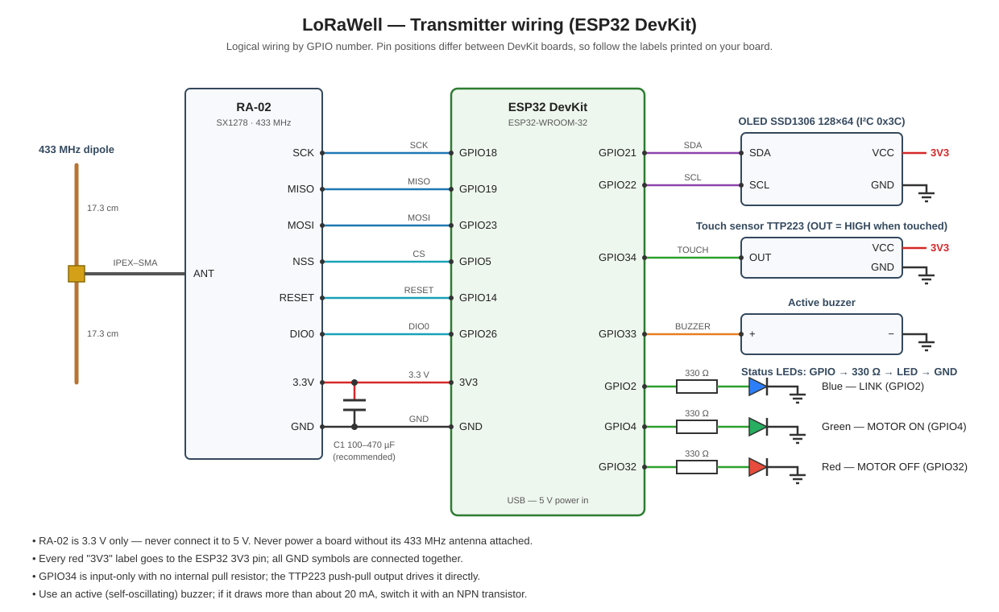
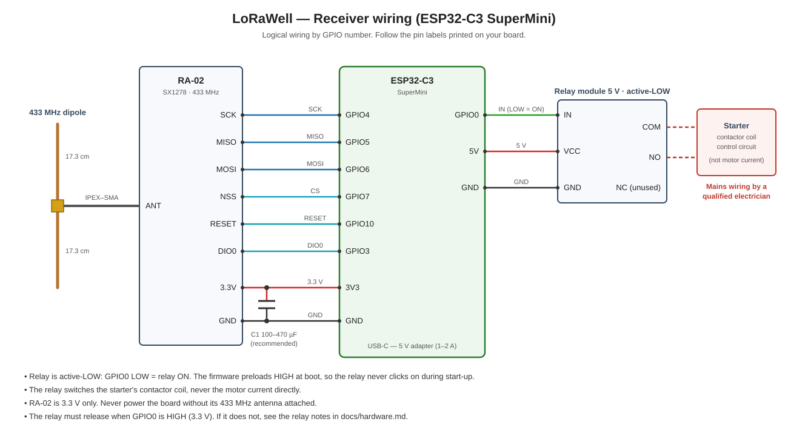

# LoRaWell — LoRa borewell motor controller

Switch a borewell pump on and off from your house over a 433 MHz LoRa link: a touch button with an OLED status display at home, a relay at the pump, and fail-safe FreeRTOS firmware on both ends.



## Features

- **Touch control**: hold 1–4 s to toggle the motor, triple-tap for a 10-minute run, hold 4 s for a 15-minute run.
- **Confirmed commands**: every command is acknowledged by the receiver with the real motor state, with automatic retries.
- **Live status**: the OLED shows link, motor state, mode and run time; LEDs and the buzzer confirm changes.
- **Fail-safe receiver**: relay OFF at boot, manual runs stop if the transmitter goes silent, presets always end on time.
- **Self-healing**: task watchdog on every task, automatic radio re-initialisation, restart on fatal errors.
- **FreeRTOS design**: radio, touch, UI and safety logic run as separate tasks; fixed-size buffers instead of `String`.

## Repository layout

| Path | Contents |
|---|---|
| `firmware/transmitter/` | Transmitter sketch (ESP32 DevKit) — **default, SF10** |
| `firmware/receiver/` | Receiver sketch (ESP32-C3 SuperMini) — **default, SF10** |
| `firmware/sf12-long-range/` | Alternative transmitter/receiver pair for weak or obstructed links (SF12) |
| `docs/hardware.md` | Parts list, wiring, power, relay, antenna and installation |
| `docs/protocol.md` | Radio settings, packet format, timing, safety logic, task design |
| `docs/testing.md` | Bench, field and long-run test checklists, log reference |

> **Always flash both boards from the same folder pair.** An SF10 board and an SF12 board cannot talk to each other.

## Hardware

| Unit | Main parts |
|---|---|
| Transmitter | ESP32 DevKit, RA-02 (SX1278, 433 MHz), SSD1306 128×64 I²C OLED, TTP223 touch sensor, active buzzer, 3 LEDs |
| Receiver | ESP32-C3 SuperMini, RA-02 (SX1278, 433 MHz), 5 V relay module (active-LOW) |
| Both | 433 MHz antenna (DIY 2 × 17.3 cm dipole works well), good-quality 5 V USB supply |





Full parts list, pin tables, relay and antenna notes: [docs/hardware.md](docs/hardware.md)

## Using it

### Touch controls (transmitter)

| Action | Result |
|---|---|
| Hold 1–4 s, then release | Toggle motor ON/OFF (manual mode) |
| 3 quick taps (each under 1 s, gaps under 0.7 s) | Start a **10-minute** run (`T10`) |
| Hold 4 s | Start a **15-minute** run (`T15`) |

Commands are accepted only while the link is up. Presses made while a command is still waiting for its acknowledgement are ignored.

### Indicators

| Indicator | Meaning |
|---|---|
| Blue LED fast blink | No link |
| Blue LED short pulse every 2 s | Link OK |
| Green LED | Motor ON (confirmed by the receiver) |
| Red LED | Motor OFF (confirmed by the receiver) |
| Both motor LEDs off | Motor state unknown (no link) |
| Double beep | Link established or restored |
| Single beep | Receiver confirmed a motor state change |
| OLED `WAIT ACK` | Command sent, waiting for confirmation |

### Safety behaviour (receiver)

- The relay is forced **OFF** at power-up and after any reset.
- A **manual ON** run stops automatically if the transmitter is silent for 10 s (60 s in the SF12 version).
- **10/15-minute presets** keep running if the transmitter is switched off, and stop on time.
- A frozen task triggers a watchdog reset, which also switches the relay OFF.

> This controller does **not** replace the starter's own overload and dry-run protection.

## Build and upload

1. Arduino IDE 2.x with the **esp32 by Espressif Systems** board package 3.x (compiled with 3.3.12; 2.x is also supported).
2. Libraries (Library Manager): **LoRa** by Sandeep Mistry, **Adafruit SSD1306**, **Adafruit GFX Library** (pulls in **Adafruit BusIO**).
3. Board settings:

   | Sketch | Board | Notes |
   |---|---|---|
   | `transmitter.ino` | ESP32 Dev Module | — |
   | `receiver.ino` | ESP32C3 Dev Module | **USB CDC On Boot: Enabled** to see logs over USB |

4. Serial Monitor at **115200 baud**.

With `arduino-cli`:

```bash
arduino-cli compile --fqbn esp32:esp32:esp32 firmware/transmitter
arduino-cli compile --fqbn esp32:esp32:esp32c3:CDCOnBoot=cdc firmware/receiver
```

## Which firmware version?

| | `firmware/` (default) | `firmware/sf12-long-range/` |
|---|---|---|
| Spreading factor | SF10 | SF12 (about +5 dB sensitivity) |
| Command confirmation | about 1 s | about 4 s |
| Heartbeat | every 2.5 s | every 15 s, fast retries after a miss |
| LINK LOST shown after | 8 s | 40 s |
| Manual-run failsafe | 10 s | 60 s |
| Status | Tested on hardware (about 400 m, buildings in between, DIY dipoles) | Compile-tested only |

Use the default. Switch **both** boards to SF12 only if the field SNR is regularly below −5 dB or `[LINK LOST]` keeps appearing — see [docs/testing.md](docs/testing.md).

## Troubleshooting

| Symptom | Likely cause and fix |
|---|---|
| Frequent `LINK LOST` / reconnect beeps | Wrong antenna (a 2.4 GHz WiFi antenna wastes most of the signal) or poor placement. Use 433 MHz antennas, vertical, away from metal, near a window or outside. |
| Never connects | Boards on different firmware pairs (SF10 vs SF12), wiring error, or `LoRa init failed` in the log |
| Relay does not release | 5 V relay module driven from 3.3 V — see the relay notes in [docs/hardware.md](docs/hardware.md#relay) |
| `COMMAND FAILED` | Link too weak — check SNR in the log |

## Limitations

- **No pairing or encryption**: any LoRaWell transmitter in range can control any LoRaWell receiver. Fine for a single installation; add a unique pair ID before installing several units within range of each other.
- 17 dBm at 433 MHz with frequent heartbeats may exceed licence-free limits in some countries — check your local rules.
