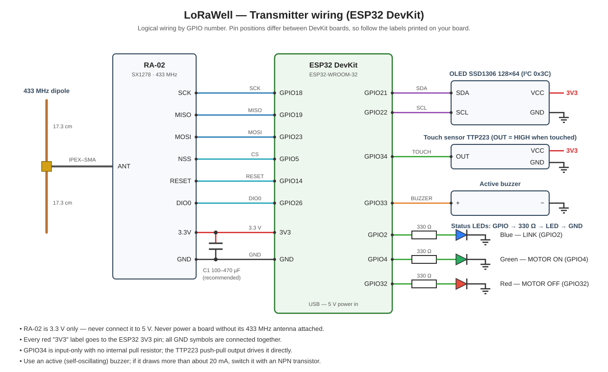
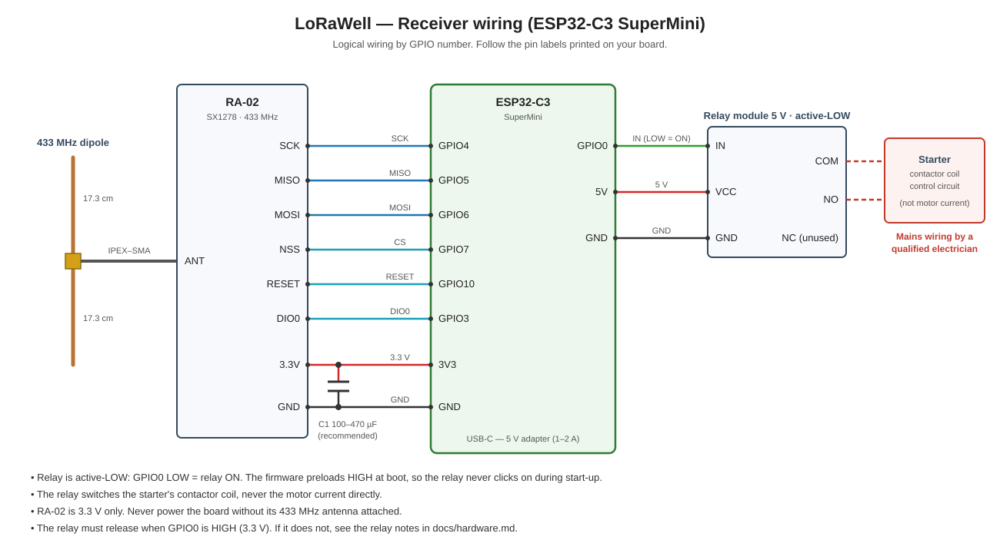
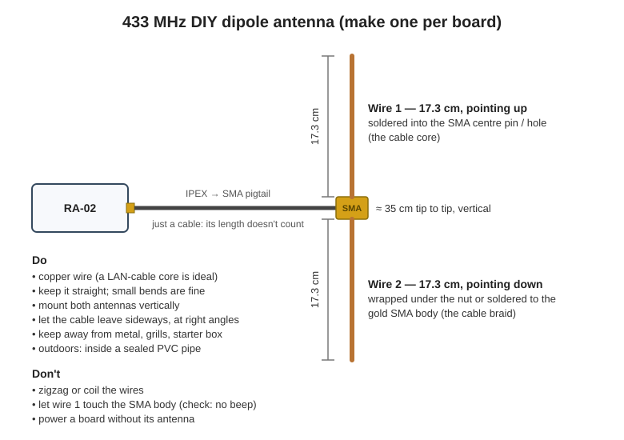

# Hardware

## Parts list

### Transmitter (house)

| Qty | Part | Notes |
|---|---|---|
| 1 | ESP32 DevKit (ESP32-WROOM-32) | "ESP32 Dev Module" in Arduino IDE |
| 1 | RA-02 LoRa module (SX1278, 433 MHz) | 3.3 V only |
| 1 | SSD1306 0.96" OLED, 128×64, I²C | address `0x3C` |
| 1 | TTP223 capacitive touch module | default mode: output HIGH while touched |
| 1 | Active buzzer | self-oscillating type |
| 3 | LEDs (blue, green, red) + 3 × 330 Ω resistors | |
| 1 | IPEX (U.FL) → SMA pigtail + 433 MHz antenna | see [Antenna](#antenna) |
| 1 | 100–470 µF electrolytic capacitor | across RA-02 3.3 V / GND, recommended |
| 1 | 5 V USB supply | |

### Receiver (pump house)

| Qty | Part | Notes |
|---|---|---|
| 1 | ESP32-C3 SuperMini | "ESP32C3 Dev Module" in Arduino IDE |
| 1 | RA-02 LoRa module (SX1278, 433 MHz) | 3.3 V only |
| 1 | 1-channel 5 V relay module, active-LOW | switches the starter coil, not the motor |
| 1 | IPEX (U.FL) → SMA pigtail + 433 MHz antenna | see [Antenna](#antenna) |
| 1 | 100–470 µF electrolytic capacitor | across RA-02 3.3 V / GND, recommended |
| 1 | 5 V 1–2 A USB adapter | genuine brand; a basic (non fast-charge) model is preferred |
| 1 | IP65 enclosure with cable glands | |

## Transmitter wiring

| Component | Pin | ESP32 GPIO |
|---|---|---|
| RA-02 | SCK / MISO / MOSI | 18 / 19 / 23 |
| RA-02 | NSS (CS) / RESET / DIO0 | 5 / 14 / 26 |
| RA-02 | 3.3V / GND | 3V3 / GND |
| OLED | SDA / SCL | 21 / 22 |
| OLED | VCC / GND | 3V3 / GND |
| Touch (TTP223) | OUT | 34 |
| Touch (TTP223) | VCC / GND | 3V3 / GND |
| Buzzer | + / − | 33 / GND |
| Blue LED (link) | anode via 330 Ω | 2 |
| Green LED (motor ON) | anode via 330 Ω | 4 |
| Red LED (motor OFF) | anode via 330 Ω | 32 |

GPIO34 is input-only and has no internal pull resistor; the TTP223's push-pull output drives it directly.

## Receiver wiring

| Component | Pin | ESP32-C3 GPIO |
|---|---|---|
| RA-02 | SCK / MISO / MOSI | 4 / 5 / 6 |
| RA-02 | NSS (CS) / RESET / DIO0 | 7 / 10 / 3 |
| RA-02 | 3.3V / GND | 3V3 / GND |
| Relay module | IN | 0 |
| Relay module | VCC / GND | 5V / GND |

GPIO0 is not a strapping pin on the ESP32-C3 and is high-impedance during reset, so an active-LOW relay stays off while the board boots.

## Power

- The RA-02 is **3.3 V only**. Power it from the board's 3V3 pin and place 100–470 µF (plus 100 nF) close to its VCC/GND; transmit current peaks around 100–120 mA.
- Use a **genuine** 5 V USB adapter. A basic 5 V 1–2 A model is preferred over fast chargers: the ESP32-C3 SuperMini's regulator only tolerates about 6 V.
- The receiver plus relay draws about 0.15 A; the transmitter about 0.1 A.
- Where lightning or mains spikes are common, plug the receiver's adapter into a surge-protected socket.

## Relay

- Active-LOW: `GPIO0 LOW` = relay energised. Change `RELAY_ACTIVE` / `RELAY_INACTIVE` in `receiver.ino` for other modules.
- Use the relay contacts to switch the **starter / contactor coil (control circuit)**, never the motor current. Mains wiring must be done by a qualified electrician.
- Many 5 V relay modules do not fully release when driven with a 3.3 V HIGH. Check that the relay clicks OFF during boot and on an OFF command. If it does not:
  - If the module has a **JD-VCC jumper**: remove it, connect VCC → 3V3 and JD-VCC → 5 V.
  - Otherwise drive IN through an NPN transistor (10 kΩ pull-down on the base). This inverts the logic, so swap `RELAY_ACTIVE` and `RELAY_INACTIVE`.

## Antenna

The RA-02 transmits at 433 MHz. A 2.4 GHz WiFi antenna is about 6× too short for this and wastes most of the signal. A simple dipole on the existing IPEX → SMA pigtail works well:

1. Keep the pigtail. It is only a cable: its length does not count towards the antenna.
2. **Wire 1:** 17.3 cm of copper wire (a LAN-cable core is ideal) soldered into the SMA centre pin or hole, pointing up.
3. **Wire 2:** 17.3 cm wrapped under the nut or soldered to the gold SMA body (the braid side), pointing down.
4. Check with a multimeter that the two wires are **not** connected to each other.

Why 17.3 cm: a 433 MHz wave is about 69 cm long, and each arm is a quarter of that. ±1 cm makes almost no difference; copper or tinned-copper wire of any normal thickness is fine.

Rules:

- Straight wires; small bends are fine, zigzags and coils are not.
- **Both antennas vertical** (which end points up does not matter).
- Away from metal: window grills, the starter box, steel frames.
- Outdoors, put the antenna inside a sealed PVC pipe.
- **Never power a board without its antenna attached.**

## Installation tips

- Mount the antennas as high as practical, near a window or outside, facing the other end. Antennas above the roofline clear the buildings in between.
- Keep the receiver and its antenna away from the starter's metal box and the motor cables.
- If a board must stay indoors, an SMA extension cable (RG58, 3–5 m) can take the antenna outside for only 1–2 dB of loss.
- Use an IP65 enclosure, shaded from direct sun, with a silica-gel pack inside.
