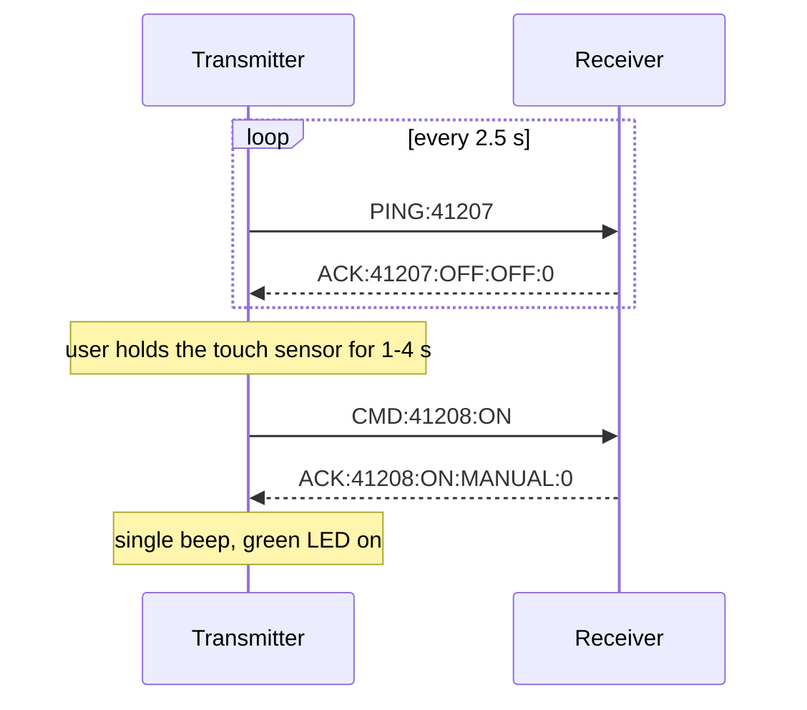

# Radio protocol and firmware design

## Radio settings

Both boards must use identical settings.

| Setting | Default | SF12 version |
|---|---|---|
| Frequency | 433 MHz | 433 MHz |
| Spreading factor | 10 | 12 |
| Bandwidth | 125 kHz | 125 kHz |
| Coding rate | 4/8 | 4/8 |
| Preamble | 12 symbols | 12 symbols |
| Sync word | `0x42` | `0x42` |
| TX power | 17 dBm | 17 dBm |
| CRC | on | on |

## Packets

All packets are short ASCII strings.

| Direction | Packet | Meaning |
|---|---|---|
| Transmitter → receiver | `PING:<id>` | Heartbeat; the receiver answers with an ACK |
| Transmitter → receiver | `CMD:<id>:ON` | Manual ON |
| Transmitter → receiver | `CMD:<id>:OFF` | OFF |
| Transmitter → receiver | `CMD:<id>:T10` | Run for 10 minutes |
| Transmitter → receiver | `CMD:<id>:T15` | Run for 15 minutes |
| Receiver → transmitter | `ACK:<id>:<ON\|OFF>:<mode>:<elapsed_s>` | Current state. `<mode>` is `OFF`, `MANUAL`, `PRESET10` or `PRESET15` |

- IDs start from a random number at every transmitter boot, so the receiver never mistakes a new command for a retry from an earlier session.
- The receiver remembers the last command ID: a retry with the same ID is acknowledged again but **not executed twice**.
- A command counts as confirmed only when an ACK with the same ID arrives.

### Example exchange (default firmware)

## Timing

| | Default (SF10) | SF12 version |
|---|---|---|
| Approx. airtime PING / ACK | 0.4 s / 0.6 s | 1.3 s / up to 2.4 s |
| Heartbeat | every 2.5 s, paused while a command is pending | every 15 s + 0–1 s jitter; only one exchange in flight |
| ACK timeout | 1.5 s | 3.5 s, then retry after 1–2 s |
| Command attempts | 3 | 5 |
| Transmitter shows LINK LOST after | 8 s without an ACK | 40 s without an ACK |
| Receiver stops a MANUAL run after | 10 s without a valid packet | 60 s without a valid packet |
| Radio re-initialised after silence | 30 s | 60 s |

## Receiver safety logic

- The relay output level is preloaded inactive before the pin driver is enabled, so the relay never pulses on at boot.
- `safetyTask` runs every 50 ms at the highest priority: it ends presets on time, stops MANUAL runs when the transmitter goes silent, and re-asserts the relay output.
- Only valid `PING` / `CMD` packets refresh the link watchdog; noise and malformed packets are ignored.
- Presets are time-limited, so they continue even if the transmitter is switched off. MANUAL runs have no time limit, so they need a live transmitter.

## Firmware structure

### Transmitter (ESP32, dual core)

| Task | Core | Priority | Job |
|---|---|---|---|
| `radioTask` | 0 | 4 | Only task that uses LoRa/SPI: heartbeat, commands, retries, ACK parsing, link state, radio recovery |
| `touchTask` | 1 | 3 | Samples the touch sensor every 10 ms, debounces, detects gestures, queues commands |
| `uiTask` | 1 | 1 | Only task that uses I²C: OLED (on change and every 500 ms), LEDs, buzzer, `[HEALTH]` log |

### Receiver (ESP32-C3, single core)

| Task | Priority | Job |
|---|---|---|
| `safetyTask` | 5 | Relay, preset timer, link watchdog, `[HEALTH]` log |
| `radioTask` | 4 | Only task that uses LoRa/SPI: packet parsing, command execution, ACKs, radio recovery |

Shared state is protected by a mutex; tasks communicate through FreeRTOS queues and task notifications. Every task is registered with the ESP32 task watchdog (10 s timeout, reset on expiry). All `millis()` arithmetic is wrap-safe, so the boards can run continuously.
